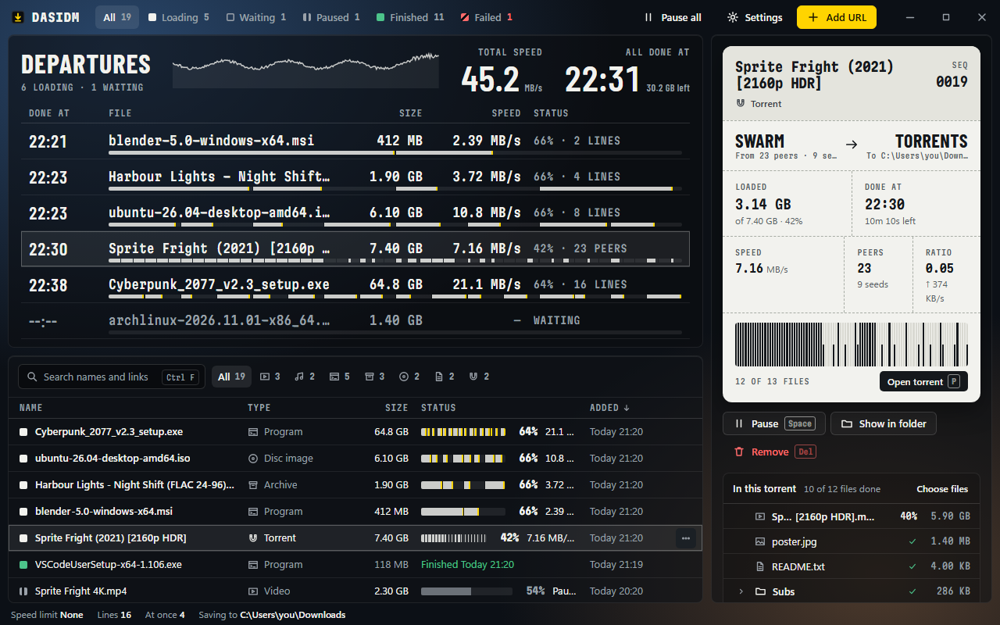

# DasIDM

A fast download manager for Windows, written from scratch in Rust (engine and core), Tauri 2 (shell) and Svelte 5 (UI). Files over many parallel connections, video and music from websites, torrents with editable trackers, and a Firefox add-on that hands your downloads to it. It idles in the tray at a few megabytes of RAM.



## Download

- **DasIDM for Windows 10/11:** the installer is on the [Releases page](https://github.com/ApurvDas/dasidm/releases/latest) (`DasIDM_<version>_x64-setup.exe`). It installs for your Windows user only, so it needs no admin rights. The installer isn't code-signed yet, so Windows SmartScreen may say "Windows protected your PC": click **More info → Run anyway**. Each release lists the installer's SHA-256 so you can check it.
- **Firefox add-on, "DasIDM – Download Manager":** on addons.mozilla.org (the link follows once Mozilla has reviewed it). It needs DasIDM installed.

## What it does

**Files.** 1 to 32 connections per file with work stealing: an idle connection takes half of the biggest remaining range, so every line stays busy until the last byte. Pause, resume and crash safety: progress is saved every 2 seconds and checked against the server's ETag and Last-Modified when you resume. Retries with backoff, a global live speed limit, a queue with "N at once", and file types sorted into folders. A link that turns out to be a web page asks before saving it.

**Video and music** from YouTube and the other sites yt-dlp reads. A quality picker shows every resolution as "MP4 · H.264 · plays everywhere" or best quality (VP9/AV1), and sound-only as M4A, MP3 320, Opus or FLAC. Playlists, titles, artists and cover art are embedded. The tools (yt-dlp, FFmpeg, Deno) are downloaded once, only after you agree, from their publishers' GitHub releases, and each file is checked against the publisher's SHA-256 list before use.

**Torrents.** Magnet links, .torrent links and files. See the folders and files before adding, pick what to fetch, and watch each file fill while it loads. qBittorrent-style trackers you can edit while it runs: each tracker's status, seeds, peers and next announce; add, edit, remove, Ask all now. A piece map; seeding to a ratio or time limit; upload limit, port, UPnP and DHT settings.

**Firefox.** With the add-on, files you download in Firefox open in DasIDM's Add sheet, with the site's cookie and referrer so files behind a login work. Press Enter to start. Alt+click a link to keep that one in Firefox; right-click a link for "Download with DasIDM". If DasIDM can't take a download, Firefox simply keeps it.

**The window.** A "Gate Board" design on Windows 11 Mica glass:
- a departures board of active downloads ranked by finish time;
- a list where each download's bar is cut into its pieces, each filling on its own, with the percentage beside it;
- a boarding-pass view of the selected download with a live map of every connection.

Right-click any download to open, pause, resume, start or stop seeding, show in folder, copy its link, remove it from the list, or delete it from the PC (which asks first). Closing the window unloads it completely; downloads continue in the tray.

Keyboard: `Ctrl+V` add a copied link · `Ctrl+N` add · `Space` pause or resume · `Enter` open · `P` parts or torrent view · `Del` remove · `Shift+Del` delete from PC · `Shift+F10` actions · `Ctrl+F` search · `↑ ↓` move.

From the command line (also hands links to a running DasIDM): `dasidm.exe https://example.com/file.iso`, or `dasidm.exe --background` to start in the tray.

## Privacy

No account, no telemetry, no ads. The add-on talks only to DasIDM on the same PC. See [PRIVACY.md](PRIVACY.md).

## Build from source

Requirements: Rust (MSVC toolchain), Node 20+, WebView2 (built into Windows 11).

```powershell
cd app
npm install
npx tauri dev                 # run with hot reload
npx tauri build               # installer in target/release/bundle/nsis
npx tauri build --no-bundle   # just target/release/dasidm.exe
```

`npm run dev` alone serves the UI in a normal browser with sample data (no Rust needed), for design work.

Tests:

```powershell
cargo test --workspace
npm test --prefix extension    # the add-on's capture rules
npm run lint --prefix extension  # Mozilla's add-on checker
```

### The Firefox add-on

`extension/firefox` is plain JavaScript with no build step. `DasIDM.exe` is its own native messaging host: Firefox starts it, and it relays each message over a named pipe that only your Windows account can reach (no network port) to the running DasIDM, starting it in the tray if needed. DasIDM registers this on every start (`%LOCALAPPDATA%\DasIDM\browser` and `HKCU\Software\Mozilla\NativeMessagingHosts\dev.dasidm.host`) and unpacks the add-on there. Settings → Firefox shows the state, opens that folder and repairs it.

To try a development copy: Firefox → `about:debugging` → This Firefox → Load Temporary Add-on… → `manifest.json` in that folder. `extension\sign.ps1` signs it with your own addons.mozilla.org API key (it asks in the terminal and never saves the key).

## Layout

```
crates/das-engine   download engine (no UI, no database)
crates/das-core     manager: SQLite, queue, categories, settings, video, torrents
crates/das-torrent  BitTorrent session on librqbit (patched copy in third_party/)
app/src-tauri       Tauri shell: commands, tray, Mica window, Firefox helper
app/src             Svelte UI
extension/firefox   Firefox add-on
```

Your downloads list and settings live in `%APPDATA%\dev.dasidm.app`.

## Contributing

Issues and pull requests are welcome. Work goes on a branch, one commit per step with tests passing, and commit messages follow Conventional Commits (`feat:`, `fix:`, `docs:`…).

## Licence

Apache License 2.0; see [LICENSE](LICENSE) and [NOTICE](NOTICE). DasIDM was written from scratch, inspired by the feature set of [Prism Download Manager](https://github.com/FortoGraphy/prism-download-manager). It is not affiliated with Internet Download Manager or Tonec Inc.
